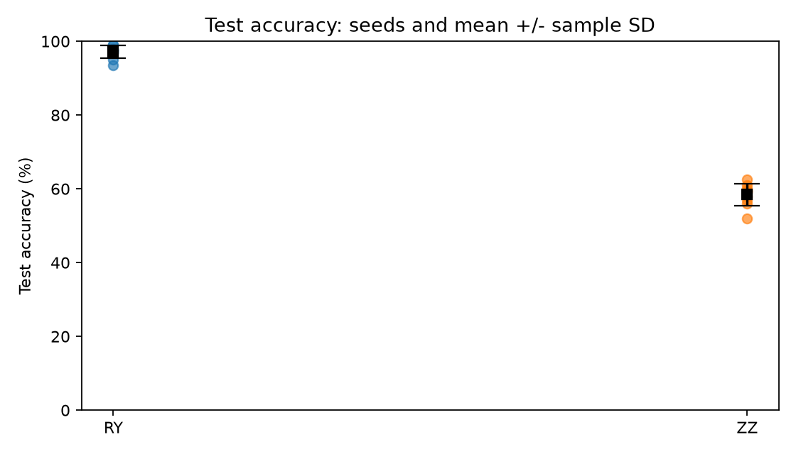
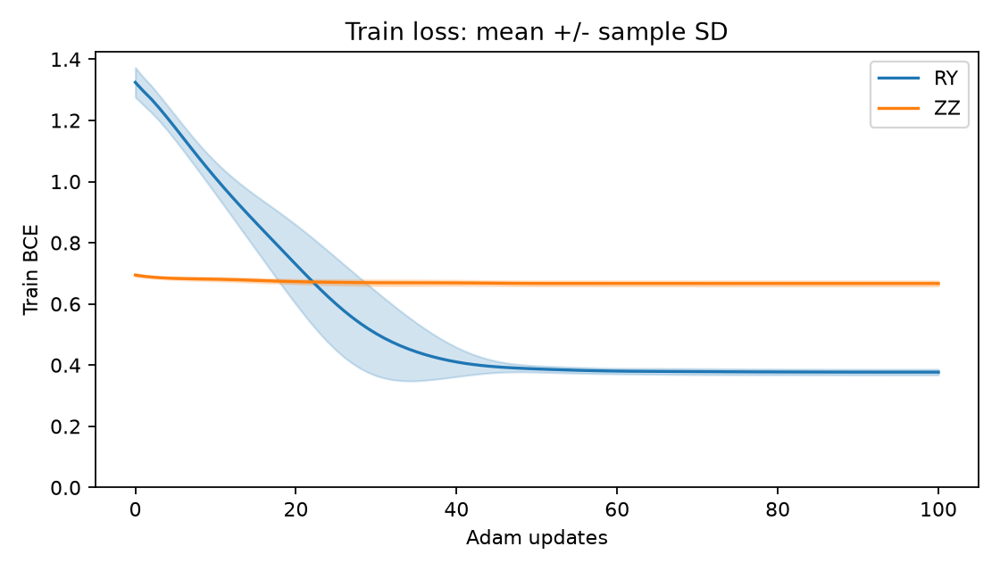
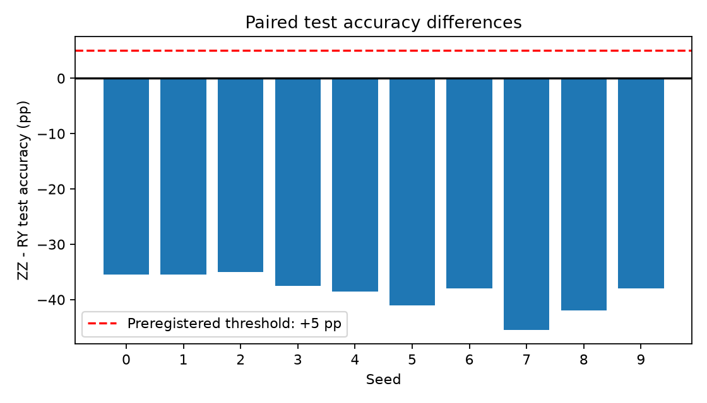
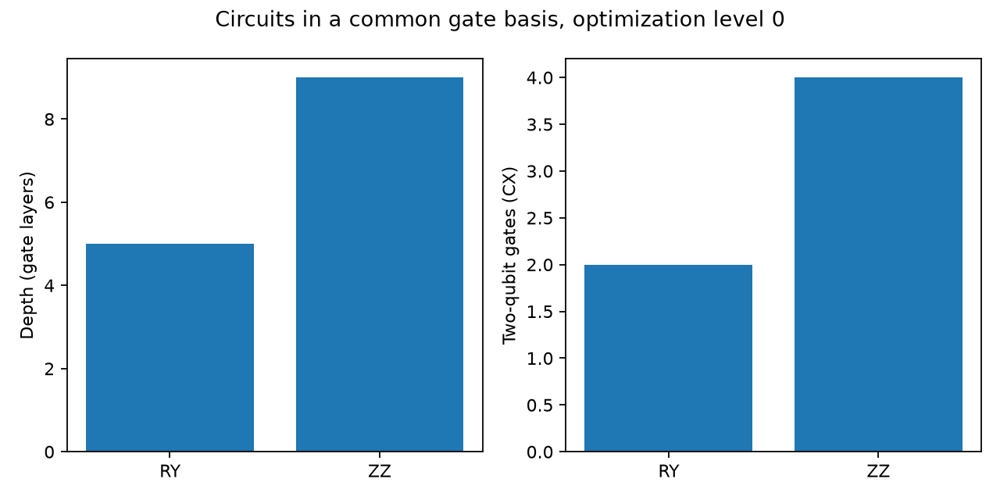
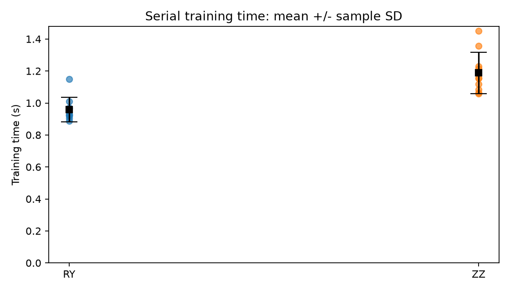
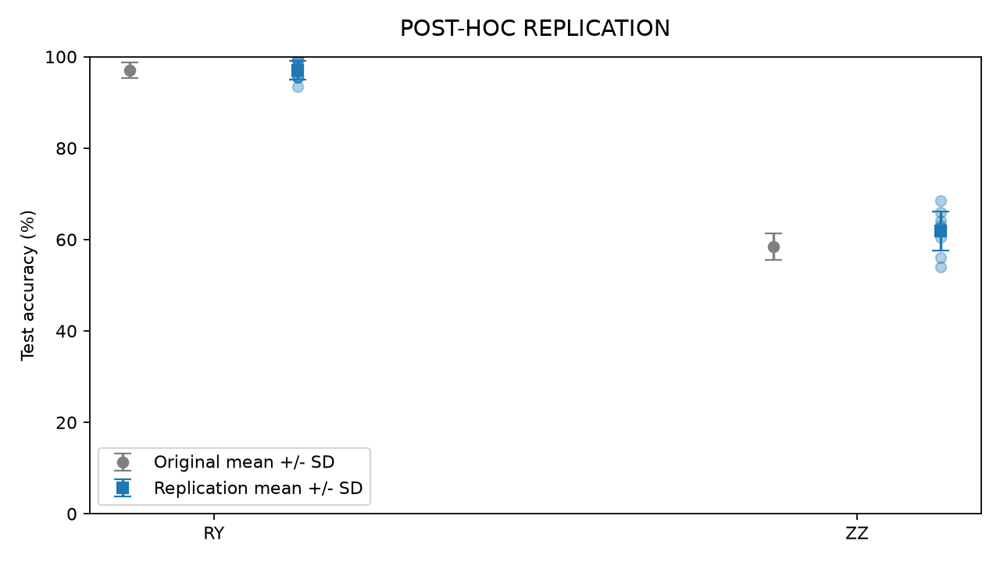
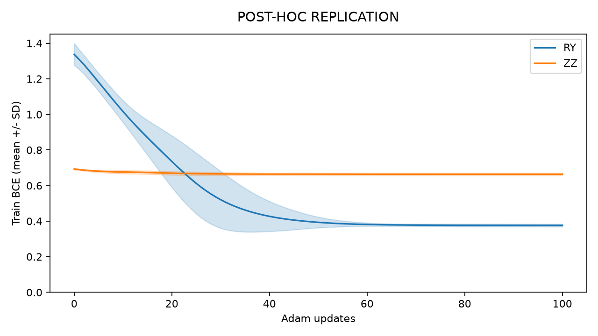
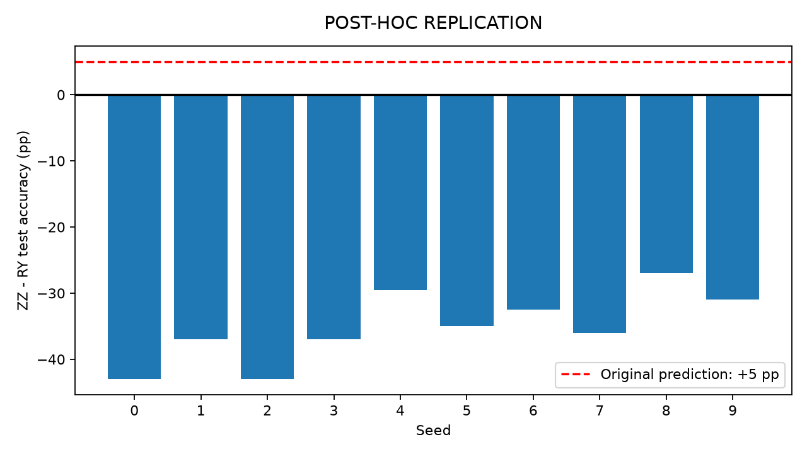
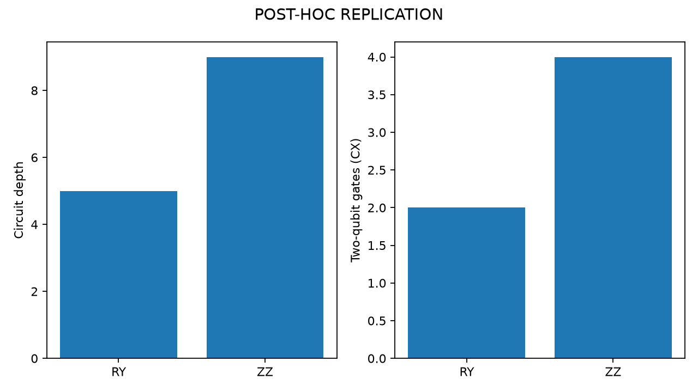
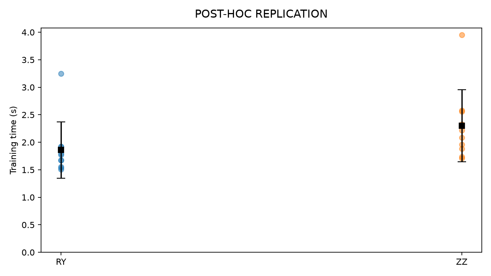

# QCODE — Quantum Coding of Data

## Cel projektu i pytanie badawcze

Celem projektu jest porównanie dwóch sposobów kodowania klasycznych danych w stanach kwantowych przy kontrolowanych warunkach uczenia klasyfikatora wariacyjnego.

**Pytanie badawcze:** Czy ZZ Feature Map zapewni wyższą średnią dokładność klasyfikacji na zbiorze testowym niż RY Angle Encoding dla syntetycznych danych z interakcjami między dwiema cechami?

## Porównanie kodowań

| Właściwość | RY Angle Encoding | ZZ Feature Map |
| --- | --- | --- |
| Kodowanie dwóch cech | Osobne obroty RY na dwóch kubitach | Obroty fazowe zależne od cech oraz człon ZZ zależny od pary cech |
| Interakcje na etapie kodowania | Brak jawnego członu łączącego cechy | Jawny człon dwukubitowy łączący cechy |
| Splątanie | Samo kodowanie lokalnymi RY nie splątuje początkowego stanu produktowego | Może wytworzyć splątanie dla odpowiednich danych i parametrów mapy |

Przyjmujemy RY Angle Encoding w postaci:

$$
U_{\mathrm{RY}}(x) = R_Y(x_1) \otimes R_Y(x_2).
$$

Dla ZZ Feature Map przyjmujemy jedną warstwę mapy, z konwencją:

$$
U_{\mathrm{ZZ}}(x) = \exp\left(i\,\phi_{12}(x) Z_1 Z_2\right)\exp\left(i(x_1 Z_1 + x_2 Z_2)\right)(H \otimes H),
$$

$$
\phi_{12}(x) = (\pi - x_1)(\pi - x_2).
$$

Operatory działają od prawej do lewej, a oba kodowania rozpoczynają od stanu zerowego dwóch kubitów. Ta definicja ustala konwencję matematyczną; późniejsza implementacja powinna zachować ją przy rozkładzie na bramki.

## Hipoteza i mechanizm

**Przewidywanie:** ZZ osiągnie średnią test accuracy co najmniej 5 punktów procentowych wyższą niż RY.

Dla 10 powtórzeń definiujemy różnicę:

$$
\Delta = \frac{1}{10}\sum_{s=1}^{10}\left(\mathrm{acc}_{\mathrm{ZZ},s} - \mathrm{acc}_{\mathrm{RY},s}\right).
$$

Dokładności zapisujemy jako ułamki od 0 do 1. Hipoteza przewiduje:

$$
\Delta \geq 0.05.
$$

Człon ZZ uzależnia fazę stanu od wspólnej funkcji dwóch cech. Dzięki temu interakcje cech są obecne już w reprezentacji wejściowej. Lokalne obroty RY kodują każdą cechę osobno; interakcje musi następnie odwzorować ansatz. Przy ograniczonej głębokości ansatzu ZZ może więc ułatwić rozdzielenie klas zależnych od relacji między cechami. Nie gwarantuje to przewagi: wynik zależy także od danych, optymalizacji i dopasowania mapy do zadania.

## Plan eksperymentu

1. Użyć dokładnie **2 kubitów** oraz syntetycznego zadania binarnego z dwiema cechami i interakcją typu XOR. W każdym powtórzeniu zaplanować 1000 niezależnych obserwacji z cechami z rozkładu jednostajnego na przedziale od -1 do 1. Etykieta wynosi 1, gdy iloczyn cech jest ujemny, i 0 w przeciwnym przypadku. Nie dodawać szumu etykiet.
2. Wykonać **10 sparowanych powtórzeń**, z ziarnami losowości od 0 do 9. Dla każdej pary RY/ZZ wykorzystać identyczne dane oraz identyczny stratyfikowany podział: 80% trening i 20% test.
3. Przeskalować cechy liniowo do przedziału od 0 do pi, korzystając ze znanych granic generatora. Zastosować identyczne przekształcenie w obu wariantach, bez dopasowywania do testu.
4. Po każdym kodowaniu zastosować **identyczny ansatz**: dwie warstwy, w każdej trenowalne obroty RY na obu kubitach i CNOT z kubitu 0 do kubitu 1. Oba modele mają tyle samo parametrów i identyczną inicjalizację w danym powtórzeniu.
5. Utrzymać **identyczne warunki treningu**: bezszumowy symulator stanu, dokładne wartości oczekiwane bez próbkowania pomiarów, pełny zbiór treningowy w każdym kroku, binarna entropia krzyżowa, optymalizator Adam, learning rate 0.05 i 100 kroków. Parametry początkowe losować jednostajnie z przedziału od -0.1 do 0.1 z ziarnem danego powtórzenia.
6. Prawdopodobieństwo klasy 1 wyznaczać z wartości oczekiwanej Z na kubicie 0 jako połowę różnicy między 1 a tą wartością; klasyfikować do klasy 1 przy prawdopodobieństwie co najmniej 0.5. Oceniać końcowy stan treningu, bez wyboru modelu według wyniku testowego.
7. Zmierzyć accuracy na odłożonym teście dla każdego modelu i powtórzenia. Raportować wszystkie 10 par, średnie accuracy, odchylenia standardowe oraz średnią sparowaną różnicę. Nie dostrajać konfiguracji po obejrzeniu testu.

## Kryterium obalenia przewidywania

Przewidywanie zostaje obalone w tym zaplanowanym eksperymencie, jeśli średnia sparowana różnica test accuracy jest mniejsza niż 0.05, czyli przewaga ZZ jest mniejsza niż 5 punktów procentowych. Równość 0.05 spełnia przewidywanie. Jest to kryterium opisowe dla tej konfiguracji i tych 10 powtórzeń, a nie dowód uniwersalnej przewagi ani test istotności statystycznej.

## Implementacja i zamrożony protokół

Publiczne repozytorium: [QCODE-Quantum-Data-Encoding](https://github.com/frani0k/QCODE-Quantum-Data-Encoding).

Eksperyment przeprowadzono 2026-11-02 po prerejestracji. Commit hipotezy: `73994d8d863ad04dfb5d80a8ed004c5c67165b68`. W tym commicie znajdowały się README i puste pliki, bez wyników. Powyższa hipoteza, plan i kryterium obalenia zachowują pierwotną treść.

Pełny protokół: [experiment_protocol.json](experiment_protocol.json). Hash protokołu i kodu sprzed uruchomienia: [audit/prerun.json](audit/prerun.json). Kopia konfiguracji i hash przy wynikach: [results/configuration.json](results/configuration.json). Nie zmieniano protokołu po obejrzeniu wyników.

Użyto Python 3.14.0, Qiskit 2.6.1, NumPy 2.5.4, Matplotlib 3.11.2 i pytest 9.2.0. W requirements.txt przypięto też zależności pośrednie (m.in. SciPy wykorzystywane przez Qiskit). Pełne środowisko: [results/environment.json](results/environment.json).

Dla każdego seeda generuje się 1000 punktów o dwóch niezależnych cechach Uniform[-1,1). Etykieta to `int(x0*x1 < 0)`, bez szumu. Skalowanie `(x+1)*pi/2` korzysta ze znanych granic, bez dopasowywania na teście. Stratyfikacja przydziela klasom zaokrąglone w dół kwoty testowe, a pozostałe miejsca według największej części ułamkowej, z remisem na rzecz klasy 0. Jest dokładnie 800 obserwacji treningowych i 200 testowych. Dane, indeksy oraz etykiety zapisano w `results/dataset_seed_*.npz`.

W pierwszym eksperymencie generowanie, podział i inicjalizacja używały osobnych instancji `default_rng(seed)` z tym samym seedem. Nie były to niezależne strumienie; wykryte sprzężenie i jego kontrolną replikację opisano w sekcji audytu metodologicznego. W parze RY/ZZ dane, podział i cztery parametry początkowe są identyczne. Nie wybiera się najlepszego seeda ani najlepszego kroku.

### Konwencje bramek i trening

Cecha j trafia na kubit j. Kolejność bazy Qiskit to `|q1 q0>`; tensorowy zapis RY w prerejestracji oznacza lokalne przypisanie cech, a w porządku macierzy Qiskit operator kubitu 1 stoi po lewej. Stan początkowy to `|00>`. Macierz RY:

$$
R_Y(a)=\begin{pmatrix}\cos(a/2)&-\sin(a/2)\\\sin(a/2)&\cos(a/2)\end{pmatrix}.
$$

Konwencja Qiskit:

$$
R_Z(a)=e^{-iaZ/2},\qquad R_{ZZ}(a)=e^{-ia(Z\otimes Z)/2}.
$$

Dlatego dodatnie wykładniki z prerejestracji realizuje `rz(-2*x[j], j)` oraz `rzz(-2*(pi-x[0])*(pi-x[1]),0,1)` po H na obu kubitach. Nie użyto gotowej mapy o potencjalnie innej konwencji.

Ansatz ma dwie warstwy RY na obu kubitach i CX(0,1). Obserwabla to `IZ`, czyli Z0. Prawdopodobieństwo klasy 1 wynosi `(1-<IZ>)/2`, a próg to `>=0.5`. Accuracy jest odsetkiem poprawnych predykcji.

Qiskit `Statevector.from_instruction` tworzy stany po encodingu. NumPy wykonuje identyczne macierze RY i permutacje CX na całym batchu. Zgodność z pełnym obwodem Qiskit sprawdzono testami oraz w audycie wytrenowanych modeli. Symulacja jest dokładna complex128, bez szumu i shots; nie korzysta ze sprzętu kwantowego.

Adam wykonuje 100 pełnych kroków: learning rate 0.05, beta1=0.9, beta2=0.999, epsilon=1e-8, z korekcją obciążenia momentów. Funkcja straty to średnia binarna entropia krzyżowa z clippingiem do [1e-12,1-1e-12]. Parameter shift daje pochodne prawdopodobieństw, a reguła łańcuchowa gradient straty. Pochodna clippingu jest zerowa poza tym przedziałem. Historia obejmuje stratę początkową i po każdym kroku (101 wartości). Test ocenia parametry po setnym kroku.

Zasoby mierzy się w bazie `ry,rz,h,cx`, z optimization_level=0 i seed_transpiler=0, przy symbolicznych parametrach ansatzu. To koszt określonej dekompozycji, nie zoptymalizowany koszt sprzętowy. Czas `perf_counter` obejmuje przygotowanie stanów treningowych, optymalizację i historię, bez importów, ewaluacji i wykresów. Kolejność jest szeregowa: RY, potem ZZ w każdym seedzie. Czasy są opisowe i zależne od obciążenia komputera.

### Reprezentacje obwodów


### RY

Przykładowe kąty wejściowe: 0.3 i 0.7 rad.

```text
     ┌─────────┐┌──────────────┐     ┌──────────────┐
q_0: ┤ Ry(0.3) ├┤ Ry(theta[0]) ├──■──┤ Ry(theta[2]) ├──■──
     ├─────────┤├──────────────┤┌─┴─┐├──────────────┤┌─┴─┐
q_1: ┤ Ry(0.7) ├┤ Ry(theta[1]) ├┤ X ├┤ Ry(theta[3]) ├┤ X ├
     └─────────┘└──────────────┘└───┘└──────────────┘└───┘

```

### ZZ

Przykładowe kąty wejściowe: 0.3 i 0.7 rad.

```text
     ┌───┐┌──────────┐              ┌──────────────┐     ┌──────────────┐
q_0: ┤ H ├┤ Rz(-0.6) ├─■────────────┤ Ry(theta[0]) ├──■──┤ Ry(theta[2]) ├──■──
     ├───┤├──────────┤ │ZZ(-13.876) ├──────────────┤┌─┴─┐├──────────────┤┌─┴─┐
q_1: ┤ H ├┤ Rz(-1.4) ├─■────────────┤ Ry(theta[1]) ├┤ X ├┤ Ry(theta[3]) ├┤ X ├
     └───┘└──────────┘              └──────────────┘└───┘└──────────────┘└───┘

```

## Wyniki 10 powtórzeń

Accuracy podano w procentach, różnice w punktach procentowych. SD oznacza odchylenie standardowe próby (`ddof=1`). Każdy seed zmienia zbiór, podział i inicjalizację: zmienności nie można przypisać wyłącznie inicjalizacji.

| Seed | RY train (%) | RY test (%) | ZZ train (%) | ZZ test (%) | ZZ - RY (pp) |
| --- | ---: | ---: | ---: | ---: | ---: |
| 0 | 95.250 | 93.500 | 55.750 | 58.000 | -35.50 |
| 1 | 99.250 | 95.000 | 61.500 | 59.500 | -35.50 |
| 2 | 98.000 | 97.500 | 60.500 | 62.500 | -35.00 |
| 3 | 97.250 | 97.500 | 60.000 | 60.000 | -37.50 |
| 4 | 99.000 | 98.000 | 63.000 | 59.500 | -38.50 |
| 5 | 94.500 | 97.000 | 53.750 | 56.000 | -41.00 |
| 6 | 99.500 | 99.000 | 61.625 | 61.000 | -38.00 |
| 7 | 97.750 | 97.500 | 59.125 | 52.000 | -45.50 |
| 8 | 99.125 | 99.000 | 61.000 | 57.000 | -42.00 |
| 9 | 97.250 | 97.000 | 59.500 | 59.000 | -38.00 |

| Miara | RY | ZZ |
| --- | ---: | ---: |
| Test accuracy (%): średnia ± SD | 97.10 ± 1.70 | 58.45 ± 2.94 |
| Train accuracy (%): średnia ± SD | 97.688 ± 1.703 | 59.575 ± 2.818 |
| Końcowa train BCE: średnia ± SD | 0.3770 ± 0.0092 | 0.6668 ± 0.0084 |
| Czas treningu (s): średnia ± SD | 0.958 ± 0.076 | 1.189 ± 0.129 |
| Głębokość obwodu | 5 | 9 |
| Bramki dwukubitowe CX | 2 | 4 |
| Parametry trenowalne (nominalnie) | 4 | 4 |

Średnia sparowana różnica ZZ minus RY wynosi **-38.65 pp**, SD różnicy **3.32 pp**. ZZ przegrywa we wszystkich 10 parach; różnice wynoszą od -45.50 do -35.00 pp.

**Przewidywanie zostało obalone w tym eksperymencie:** średnia różnica jest mniejsza niż wymagane +5 pp. To kryterium opisowe z prerejestracji, bez testu istotności i bez twierdzenia o wszystkich zadaniach kwantowego uczenia maszynowego.

Źródła: [CSV](results/metrics.csv), [podsumowanie JSON](results/summary.json), [parametry i historie](results/histories.json), [zasoby](results/resources.json).

## Wykresy

Punkty pokazują powtórzenia, kwadraty średnie, a kreski i pasma SD. Accuracy ma skalę 0-100%; słupki czasu i zasobów zaczynają się od zera. Dla różnic zaznaczono zero i próg hipotezy.











Dane wykresów: [figures/plot_data.json](figures/plot_data.json). Hashe PNG: [figures/manifest.json](figures/manifest.json). Audyt porównuje serie z CSV i historiami oraz sprawdza pliki PNG i hashe. Wszystkie pięć wykresów obejrzano wizualnie lokalnie.

## Obserwacje, interpretacja i ograniczenia

**Obserwacje:** RY ma wyższą accuracy dla każdego seeda i niższą końcową stratę. ZZ ma większą zmienność test accuracy. Średnia luka train minus test to 0.5875 pp dla RY i 1.1250 pp dla ZZ. Nie widać dużego overfittingu mierzonego tą luką, ale nie jest to dowód jego całkowitego braku. Niska accuracy ZZ już na treningu sugeruje ograniczenie dopasowania lub optymalizacji; nie rozdzielono tych przyczyn.

ZZ ma 4 zamiast 2 CX i głębokość 9 zamiast 5. Jego średni czas treningu był większy o 24.0%. Nie jest to uniwersalny benchmark ani czas wykonania na sprzęcie kwantowym.

**Interpretacja analityczna:** interakcja w ZZ nie gwarantuje dopasowania do granicy klas. RY z tym ansatzem już może reprezentować XOR. Parametry `(pi/2, pi/2, -pi/2, dowolny)` dają:

$$
\langle Z_0\rangle=\cos(x_0)\cos(x_1).
$$

Po skalowaniu znak tego iloczynu odtwarza regułę etykiet poza granicą o zerowym prawdopodobieństwie w ciągłym generatorze. To wniosek matematyczny, sprawdzony testem, nie dodatkowe dostrajanie. Fazy ZZ są okresowe i mogą gorzej pasować do tej granicy przy ograniczonym ansatzu i odczycie; porównanie accuracy nie dowodzi jednak tej przyczyny. Nie izolowano wpływu splątania od osi obrotów i innych różnic map.

Ostatni obrót kubitu 1 nie wpływa na Z0: działa na innym kubicie, a końcowy CX(0,1) komutuje z Z0. Oba modele mają cztery nominalne parametry, ale jeden jest obojętny dla predykcji. Zachowano tę strukturę zgodnie z prerejestracją.

Ograniczenia: jeden generator danych, dwa kubity, jedna warstwa kodowania i dwie warstwy ansatzu. Nie badano innych skalowań, obserwabli, optimizerów, budżetów, szumu ani skończonych shots. Nie wykazano przewagi kwantowej nad klasycznym modelem. Wynik obala przewidywaną przewagę ZZ w tej konfiguracji, nie sam fakt obecności interakcji w reprezentacji.

## Co by się zmieniło, gdybyśmy zwiększyli liczbę warstw ansatzu?

**Nie sprawdzono tego eksperymentalnie.** Każda warstwa dodaje dwa nominalne parametry i jeden CX, może powiększyć rodzinę funkcji i umożliwić lepsze wykorzystanie faz ZZ. Przy zerowych nowych obrotach odczyt poprzedniego modelu pozostaje osiągalny, bo dodatkowy końcowy CX nie zmienia Z0. Nie oznacza to, że Adam znajdzie lepsze rozwiązanie przy tym samym budżecie.

RY już dobrze pasuje do tego XOR, więc jego możliwy zysk accuracy ogranicza sufit 100%. ZZ ma większy margines poprawy, ale nie wiadomo, czy dodatkowe warstwy wystarczą. Wzrasta koszt i może wzrosnąć trudność optymalizacji oraz ryzyko overfittingu. Zaniki gradientów w głębszych i większych obwodach są możliwe, ale nie wykazano ich tutaj. Ostatni obrót kubitu 1 nadal byłby niewidoczny dla odczytu. Porównanie głębokości wymaga osobnego protokołu ustalonego przed wynikami.

## Instalacja i uruchomienie

Polecenia PowerShell uruchamiaj w katalogu projektu. Referencyjne środowisko: Python 3.14.0 na Windows. Innych platform i wersji Pythona nie przetestowano.

```powershell
python -m venv .venv
.\.venv\Scripts\python.exe -m pip install -r requirements.txt
$env:PYTHONUTF8 = '1'
.\.venv\Scripts\python.exe -m pytest -q -p no:cacheprovider
.\.venv\Scripts\python.exe -B audit/final_audit.py
.\.venv\Scripts\python.exe run_experiment.py --reproduce .venv/reproduction-check
```

Polecenia `--reproduce` należy uruchamiać w roboczej kopii repozytorium: oprócz nowych pomiarów zapisują plik potwierdzenia odtworzenia. Pozwala to zachować nawet historyczne potwierdzenia bez nadpisywania. Odtwarzanie wymaga nowej, pustej ścieżki wyjściowej. Wykonuje wszystkie 20 treningów, porównuje dokładnie parametry, historie i metryki, z wyjątkiem niedeterministycznego czasu ściennego. Potwierdzenie zapisuje do `results/reproduction.json`. Pierwsze uruchomienie w kopii z pustym results:

```powershell
.\.venv\Scripts\python.exe run_experiment.py
```

Program odmawia nadpisywania wyników. Nie usuwaj zapisanych pomiarów do kontroli odtwarzalności; użyj `--reproduce`.

## Struktura projektu

```text
QCODE-Quantum-Data-Encoding/
├── README.md
├── requirements.txt
├── .gitignore
├── experiment_protocol.json
├── run_experiment.py
├── run_rng_replication.py
├── audit_rng_replication.py
├── src/
│   ├── __init__.py
│   ├── encoding.py
│   ├── dataset.py
│   ├── replication_rng.py
│   ├── variational_classifier.py
│   ├── training.py
│   └── evaluation.py
├── tests/
│   ├── test_qcode.py
│   ├── test_rng_replication.py
│   └── test_repository.py
├── audit/
│   ├── final_audit.py
│   ├── provenance.py
│   ├── readme.py
│   └── prerun.json
├── results/
├── figures/
└── replications/rng_independent/
    ├── protocol.json
    ├── prerun.json
    ├── original_manifest.json
    ├── comparison.json
    ├── reproduction.json
    ├── results/
    └── figures/
```

Katalog results zawiera dane syntetyczne, podziały, parametry, metryki i historie pierwszego badania. Oddzielny katalog replikacji przechowuje analogiczne artefakty oznaczone POST-HOC REPLICATION. Protokoły i pomiary zachowano bez zmian. Nieużywane, puste pliki początkowego szkieletu oraz operacyjne logi przygotowania repozytorium pozostają dostępne w historii Git. Usunięcie ich z bieżącego drzewa nie oznacza usunięcia z historii.

Manifest proweniencji zachowuje historyczne sumy kontrolne. Audyt wymaga pełnej historii Git, np. zwykłego klonowania bez opcji `--depth`. Dla archiwalnych plików tekstowych uwzględnia normalizację końców linii LF/CRLF wykonywaną przez Git. Aktywne pliki badawcze są nadal kontrolowane przez swoje zapisane sumy SHA-256. Środowiska `.venv`, cache i pliki pyc są wykluczone z repozytorium.

## Testy, audyt i źródła

Bateria testów obejmuje: analityczne RY i ZZ, zależność członu ZZ od cech, normalizacja, zerowa interakcja, generowanie etykiet, podział bez przecieku, pomiar i klasyfikacja, liczba parametrów, batch kontra Qiskit, gradienty, odtwarzalność treningu, punkty procentowe, zapis/odczyt i przepływ wyników. Dodatkowe kontrole opisują obojętny parametr i reprezentację XOR. Testy nie są dowodem hipotezy.

Pełne odtworzenie 20 modeli sprawdza parametry, historie i metryki; czasu nie porównuje na równość. Kod niezależnej walidacji znajduje się w katalogu audit i w testach. Audyt obejmuje zachowanie prerejestracji i hash protokołu, kod, CSV/JSON/README, źródła wykresów, PNG i historię Git.

Wzory używają bloków `$$` i standardowych makr obsługiwanych przez GitHub Markdown. Treść i odwołania sprawdzają audyty; rzeczywiste renderowanie matematyki na GitHubie nie zostało wizualnie zweryfikowane.

Dokumentacja IBM sprawdzona 2026-11-02: [RZZGate](https://quantum.cloud.ibm.com/docs/en/api/qiskit/qiskit.circuit.library.RZZGate), [Statevector](https://quantum.cloud.ibm.com/docs/en/api/qiskit/qiskit.quantum_info.Statevector). Krótszy adres Statevector w metadanych zamrożonego protokołu jest niedostępny; poprawny podano tutaj bez zmiany protokołu. API zweryfikowano też testami z Qiskit 2.6.1.


## Audyt metodologiczny i replikacja post hoc

**POST-HOC REPLICATION — kontrola metodologiczna z 2026-11-02.** To osobne badanie po poznaniu wyników, a nie nowa prerejestracja ani zastąpienie pierwszego eksperymentu. Oryginalna hipoteza, protokół, wyniki i commit `9584308c16d6bae49561f2865bcdb90a978b5da1` pozostają zachowane. Integralność artefaktów badawczych jest kontrolowana przez [manifest oryginałów](replications/rng_independent/original_manifest.json) oraz zachowane commity Git. Manifest oddziela bieżące pliki naukowe od archiwalnych sum plików pomocniczych dostępnych w historii.

### Wada i jej matematyczna weryfikacja

Osobne wywołania `default_rng(seed)` nie dają niezależnych strumieni: rozpoczynają tę samą sekwencję. Dla tych samych pierwszych liczb jednostajnych u dane wynosiły `r=2*u-1`, a inicjalizacja `theta=0.2*u-0.1`. Zatem:

$$
\theta_{\mathrm{init}}=\frac{1}{10}(r_{0,0},r_{0,1},r_{1,0},r_{1,1}).
$$

Relację potwierdzono dla wszystkich seedów 0-9 z błędem poniżej 2e-17. Pierwsze dwie obserwacje nie zawsze były treningowe: próbka 1 trafiała na test przy seedzie 2, a próbka 0 przy seedach 5, 7 i 9. To pośrednia zależność inicjalizacji od cech testowych, choć kod nie odczytywał jawnie testowych etykiet w treningu. Także generator podziału ponownie startował z tego samego seeda.

### Naprawa i niezmienione warunki

Nowy moduł `src/replication_rng.py` tworzy dokładnie trzy dzieci `SeedSequence(seed).spawn(3)`, w ustalonej kolejności: data (spawn_key 0), split (1), initialization (2). Każde dziecko inicjalizuje osobny `default_rng` z PCG64. Zużycie jednego strumienia nie przesuwa pozostałych. Daje to zalecaną przez NumPy separację strumieni pseudolosowych z bardzo wysokim prawdopodobieństwem; skończone testy nie są dowodem absolutnej niezależności statystycznej. Dokumentacja: [NumPy SeedSequence spawning](https://numpy.org/doc/stable/reference/random/parallel.html), sprawdzona 2026-11-02, zainstalowane NumPy 2.5.4.

Każda para RY/ZZ otrzymuje ten sam dataset i podział oraz kopie tej samej inicjalizacji. Pozostają 2 kubity, 1000 obserwacji, 800/200 train/test, XOR, skalowanie, stratyfikacja, obie definicje encodingów, dwie warstwy ansatzu, Z0, BCE, Adam 0.05 i 100 kroków oraz seedy 0-9. Kod modelu i treningu jest używany bez zmian. Oryginalna ścieżka RNG pozostaje zamrożona wyłącznie do historycznego odtworzenia; replikację uruchamia osobny skrypt.

Plan replikacji zapisano przed pełnym uruchomieniem w [osobnym protokole](replications/rng_independent/protocol.json); hashe kodu i protokołu zapisano w [prerun.json](replications/rng_independent/prerun.json). Nie dobierano seedów ani ustawień po wynikach. Wszystkie nowe artefakty są w `replications/rng_independent/`, a wiersze CSV, konfiguracje, historie i wykresy mają oznaczenie POST-HOC REPLICATION.

### Wyniki kontrolne

| Encoding | Oryginał: test mean ± SD (%) | POST-HOC REPLICATION: test mean ± SD (%) | Zmiana średniej (pp) |
| --- | ---: | ---: | ---: |
| RY | 97.10 ± 1.70 | 97.00 ± 2.01 | -0.10 |
| ZZ | 58.45 ± 2.94 | 61.90 ± 4.29 | +3.45 |

| Seed | RY train (%) | RY test (%) | ZZ train (%) | ZZ test (%) | ZZ - RY (pp) |
| --- | ---: | ---: | ---: | ---: | ---: |
| 0 | 98.500 | 99.000 | 61.375 | 56.000 | -43.00 |
| 1 | 97.625 | 99.500 | 62.250 | 62.500 | -37.00 |
| 2 | 98.500 | 97.000 | 60.125 | 54.000 | -43.00 |
| 3 | 98.000 | 99.500 | 57.750 | 62.500 | -37.00 |
| 4 | 95.500 | 93.500 | 60.500 | 64.000 | -29.50 |
| 5 | 97.750 | 95.500 | 63.000 | 60.500 | -35.00 |
| 6 | 97.500 | 95.500 | 62.125 | 63.000 | -32.50 |
| 7 | 98.125 | 98.000 | 61.875 | 62.000 | -36.00 |
| 8 | 97.625 | 95.500 | 59.250 | 68.500 | -27.00 |
| 9 | 96.875 | 97.000 | 60.750 | 66.000 | -31.00 |


Średnia sparowana różnica ZZ minus RY w replikacji wynosi **-35.10 pp**, SD różnicy **5.31 pp**, wobec **-38.65 pp** w oryginale. RY wygrywa we wszystkich 10 parach; kierunek przewagi pozostaje stabilny. Przewidywanie +5 pp dla ZZ nie zostało spełnione w tej kontroli; ta ocena post hoc nie zmienia historycznego wyniku hipotezy.

Źródła: [CSV](replications/rng_independent/results/metrics.csv), [summary JSON](replications/rng_independent/results/summary.json), [historie i hashe par](replications/rng_independent/results/histories.json), [porównanie badań](replications/rng_independent/comparison.json).

### Nieaktywny parametr i interpretacja

Nie zmieniono architektury. Dla C=CX(0,1) i końcowego obrotu RY na kubicie 1 zachodzi:

$$
C^{\dagger} Z_0 C=Z_0,\qquad [R_{Y,1}(\theta_3),Z_0]=0.
$$

Dlatego odczyt i loss są niezależne od theta3; jego gradient jest analitycznie zerowy. Modele nadal mają cztery nominalne parametry, ale co najwyżej trzy aktywne w predykcji. To własność odczytu, nie dowód barren plateau. Usunięcie parametru zmieniłoby prerejestrowaną architekturę i nie jest częścią tej kontroli.

Replikacja ocenia stabilność wyniku po rozdzieleniu RNG. Zmienia realizacje danych, podziałów i inicjalizacji jednocześnie; różnic między badaniami nie można przypisać wyłącznie usunięciu sprzężenia inicjalizacji. Ten sam numer seeda nie oznacza tej samej próbki między badaniami. Nie stosujemy więc interpretacji sparowanego efektu przyczynowego między oryginałem a kontrolą.

Nadal nie rozdzielono ograniczeń reprezentacji ZZ, odczytu i optymalizacji. Mały ansatz, jeden generator XOR, brak szumu i jeden budżet nie uzasadniają ogólnej wyższości RY. SD obejmuje zmienność danych, podziałów i inicjalizacji; nie jest samą zmiennością inicjalizacji. Wynik nie dowodzi mechanizmu przyczynowego ani przewagi kwantowej.

### Wykresy i walidacja

Wszystkie nowe wykresy mają nagłówek POST-HOC REPLICATION. Accuracy ma skalę 0-100%, zasoby i czasy zaczynają się od zera. Źródła serii i hashe PNG są zapisane obok wykresów.











Testy regresyjne sprawdzają odtwarzalność, przypisanie dzieci SeedSequence, separację zużycia strumieni, zerwanie dawnego sprzężenia, wspólne dane/podział/inicjalizację par oraz zachowanie oryginalnych plików i odtwarzanie dawnych datasetów. Pełne odtworzenie replikacji porównuje parametry, historie, dane i metryki; wyłącza niedeterministyczny czas. Audyt porównuje zapisane predykcje z Qiskit i sprawdza zgodność CSV, JSON, README oraz danych wykresów.

```powershell
.\.venv\Scripts\python.exe -B -m pytest -q -p no:cacheprovider
.\.venv\Scripts\python.exe -B run_rng_replication.py --audit
.\.venv\Scripts\python.exe -B run_rng_replication.py --reproduce .venv/posthoc-reproduction-check
.\.venv\Scripts\python.exe -B audit_rng_replication.py --check
```

Pierwsze uruchomienie nowej replikacji, wyłącznie gdy osobny katalog wyników jeszcze nie istnieje: `python run_rng_replication.py`. Program odmawia nadpisania wcześniejszych pomiarów. Audyty `audit/final_audit.py` i `audit_rng_replication.py --check` są tylko do odczytu i nie modyfikują zapisanych wyników.

Testów niezależności RNG nie należy interpretować jako matematycznego dowodu niezależności wszystkich strumieni. Nie sprawdzono alternatywnego ansatzu ani wizualnego renderowania wzorów na GitHubie. Odtwarzalność zweryfikowano w świeżym środowisku z przypiętymi wersjami na Windows; innych platform nie przetestowano.
